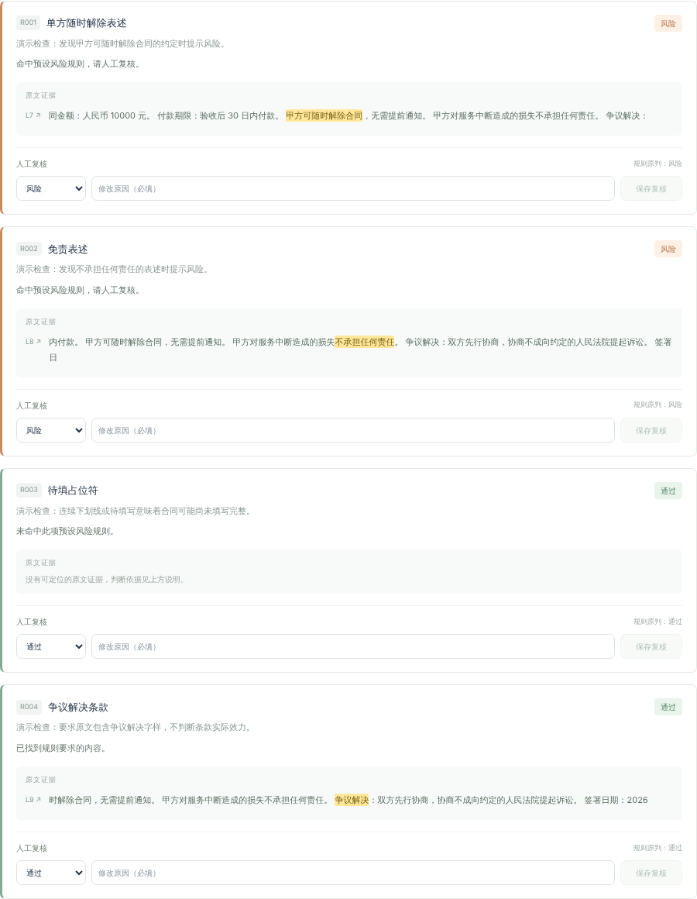
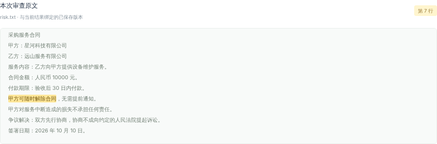
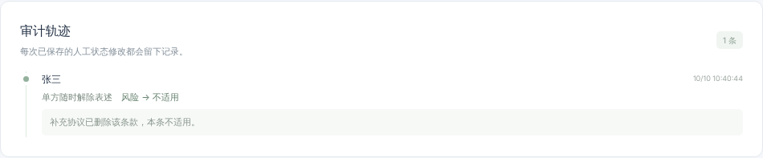
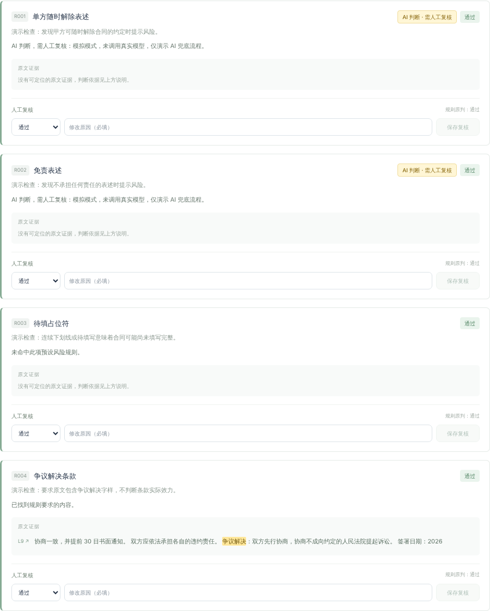

# ContractCheck · 合同规则审查 Mini

上传合同 → 规则审查 → 逐条人工复核 → 审计留痕 → 导出报告。React + Vite 前端，FastAPI + SQLite 后端，规则写在 JSON 里，新增规则不用改代码。



## 一键启动（Docker，推荐）

需要 Docker Desktop 或 Docker Engine。在仓库根目录运行：

```bash
docker compose up --build
```

- 页面：<http://localhost:5173>
- 接口文档：<http://127.0.0.1:8000/docs>
- 停止：`Ctrl+C`，或 `docker compose down`。审查数据保存在 Docker 卷中，重启不丢失；`docker compose down -v` 会清空。

想看 AI 兜底效果但没有 API key，可以开启本地模拟模式，不联网：

```bash
LLM_FALLBACK=mock docker compose up --build              # macOS / Linux
$env:LLM_FALLBACK="mock"; docker compose up --build      # Windows PowerShell
```

也可以把 `.env.example` 复制为 `.env` 后修改，Docker Compose 会自动读取。

## 本地运行（不用 Docker）

需要 Python 3.10+、Node.js 20.19+ 或 22.12+。以下命令都从仓库根目录开始，例如 `C:\Users\User\antigravityProject\ai-fullstack-training`。

后端，第一个终端：

```powershell
# Windows PowerShell
cd backend
py -3 -m venv .venv
.\.venv\Scripts\python.exe -m pip install -r requirements.txt
.\.venv\Scripts\python.exe -m uvicorn main:app --reload --host 127.0.0.1 --port 8000
```

```bash
# macOS / Linux
cd backend
python3 -m venv .venv
.venv/bin/python -m pip install -r requirements.txt
.venv/bin/python -m uvicorn main:app --reload --host 127.0.0.1 --port 8000
```

前端，第二个终端（Windows 上如果 PowerShell 拦截 `npm`，改用 `npm.cmd`）：

```bash
cd frontend
npm ci
npm run dev -- --host localhost --port 5173 --strictPort
```

然后打开 <http://localhost:5173>。前端默认请求 `http://127.0.0.1:8000`，改端口时在启动 Vite 前设置 `VITE_API_BASE_URL`。

## 演示流程

| 步骤 | 预期结果 |
| --- | --- |
| 点「两处风险样例」，再点「开始审查」 | R001、R002 为风险，其余通过；每条结果的证据片段里高亮命中文字 |
| 点击任意一条证据 | 下方原文区域高亮并滚动到对应位置，重复点击同一条也会重新定位 |
| 填写复核人，把 R001 改为「不适用」，填写原因后保存 | 审计轨迹记录操作人、时间、原状态 → 新状态和原因，规则原判保留不变 |
| 点「↓ Markdown」或「↓ JSON」 | 下载报告，含原文、证据位置、原始与最终状态、完整审计记录 |
| 点「全通过样例」，再审查 | 4 条全部通过；模拟模式下 R001、R002 标注「AI 判断 · 需人工复核」 |
| 刷新页面或重启后端 | 左侧「最近审查」可恢复历史记录 |

样例文件在 `samples/`：`pass.txt` 全部通过，`risk.txt` 恰好两处风险，也可以通过「选择合同文件」上传。

| 点击定位原文 | 人工复核审计 | AI 兜底标注 |
| --- | --- | --- |
|  |  |  |

## 需求对照

| 要求 | 实现 |
| --- | --- |
| 规则引擎：JSON 配置、关键词和正则两种算子、加规则不改代码 | `backend/rules.json`（4 条），`backend/rule_engine.py` |
| `POST /review`、`POST /report`（Markdown / JSON） | `backend/main.py` |
| 单页：上传 → 审查 → 结果列表高亮证据 → 人工改状态 → 导出 | `frontend/src/App.jsx` |
| 审计：谁、何时、改了什么、原值，写入 SQLite，报告附审计 | `backend/storage.py`，报告「人工修改审计」一节 |
| 演示数据：全通过与恰好两处风险的样例 + README | `samples/`，本文件 |
| 加分：证据精确到字符偏移并可点击定位 | 证据带 `start`、`end`、`line`、`snippet_start` |
| 加分：Docker 一键启动 | `docker-compose.yml`，`backend/Dockerfile`，`frontend/Dockerfile` |
| 加分：LLM 兜底算子，标注「AI 判断，需人工复核」 | `backend/llm.py`，见下文 |

## 规则配置

在 `backend/rules.json` 里追加一个对象即可，每次审查都会重新读取，不用改代码或重启：

```json
{
  "id": "R005",
  "name": "禁止转让条款",
  "description": "发现禁止转让的约定时提醒复核。",
  "type": "keyword",
  "pattern": "不得转让",
  "risk_when": "matched"
}
```

- `type`：`keyword` 按字面匹配，`regex` 按正则匹配。正则由开发者维护，请避免灾难性回溯。
- `risk_when`：`matched` 表示命中即风险，`missing` 表示找不到即风险。
- `llm_fallback`、`llm_question`：可选。开启后，关键词或正则未命中时交给大模型按 `llm_question` 做语义判断。

## AI 兜底（可选）

环境变量 `LLM_FALLBACK` 控制，默认 `off`，合同不会离开本机。

| 取值 | 行为 |
| --- | --- |
| `off` | 不调用模型，只用规则 |
| `mock` | 本地模拟，不联网，用来演示 AI 标注和复核流程，不改变判断结果 |
| `claude` | 调用 Anthropic Claude API，需要自行设置 `ANTHROPIC_API_KEY`；默认模型 `claude-opus-5-5`，可用 `LLM_MODEL` 覆盖 |

每份合同最多调用一次模型，只判断开启了兜底且未命中的规则。模型的结论标注为「AI 判断，需人工复核」，它摘录的原文能在合同中逐字找到时会给出可点击的证据。调用失败、限流或拒答时保留规则结果，审查照常完成。`claude` 模式会把合同全文发送给 Anthropic API，请勿用于真实保密合同。

## API

| 方法和路径 | 说明 |
| --- | --- |
| `POST /review` | `{ "filename": "合同.txt", "content": "合同原文" }`，返回完整审查并保存 |
| `GET /reviews` | 最近 20 份审查摘要 |
| `GET /reviews/{review_id}` | 已保存的原文、结果和审计 |
| `PATCH /reviews/{review_id}/results/{rule_id}` | `{ "status": "pass", "actor": "张三", "reason": "已核实", "expected_status": "risk" }` |
| `POST /report` | `{ "review_id": "审查ID", "format": "json" }`，或 `"markdown"` |

- 状态值：`pass` 通过、`risk` 风险、`not_applicable` 不适用。
- 错误码：422 输入无效或状态未变化，404 记录不存在，409 结果已被其他操作修改，503 数据库或规则配置不可用，500 未预期的服务器错误。
- 证据位置是 Unicode 码点下标，区间左闭右开。`snippet_start` 是上下文片段在原文中的起点。

保留的练习接口：`GET /health`、`POST /api/echo`、`POST /api/analyze-preview`。

## 测试

```bash
cd backend
python -m pip install -r requirements-dev.txt
python -X utf8 -m unittest discover -s tests -v    # 使用临时数据库，不会碰默认数据

cd ../frontend
npm run build
```

Windows 上把 `python` 换成 `.\.venv\Scripts\python.exe`，macOS / Linux 换成 `.venv/bin/python`。后端测试覆盖规则匹配、两份样例、证据偏移、输入校验、人工修改与审计、并发冲突、报告转义、历史排序和 AI 兜底；AI 测试只用假模型，不联网。

## 项目结构

```text
backend/    FastAPI 接口、规则引擎、SQLite 存储、AI 兜底、测试
frontend/   React 单页应用
samples/    两份演示合同
docs/       展示截图
docker-compose.yml, .env.example
```

## 数据与安全边界

- 本地运行时数据库在 `backend/data/reviews.sqlite3`，可用 `CONTRACT_DB_PATH` 改路径；Docker 中保存在 `contract-review_contract-data` 卷。数据库保存合同全文，不要提交数据库、`.env`、`.venv` 或 `node_modules`。
- 人工修改和审计写在同一个事务里；`expected_status` 用来发现过期提交，避免静默覆盖。
- 复核人是自行填写的演示身份，没有登录认证。Docker 端口只绑定本机地址，不要部署到公网。
- 规则和 AI 结果都只是演示，不构成法律意见；未发现风险不代表合同没有风险。
